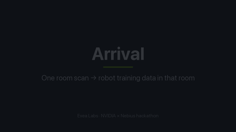

# Arrival

**Scan a room once. Get robot training data for that exact room.**

[](docs/media/demo.mp4)

*30-second demo, rendered from the real code (an early cut that predates the SIM-1 and MAN-1 visual fixes; DEM-2 refreshes it). Click for the full-quality mp4. Regenerate it with `python scripts/make_demo_video.py`.*

---

## What this is

General robot policies like NVIDIA GR00T are trained on generic kitchens. When a robot arrives in *your* kitchen, it has never seen your counters, your sink or your drawers. Arrival closes that gap:

1. **Scan.** An iPhone LiDAR scan (Apple RoomPlan) describes the room: walls, counters, sink, stove, fridge.
2. **Twin.** We compile the scan into a digital twin: a RoboCasa-style layout and a MuJoCo scene with working drawers and doors.
3. **Simulate.** A 7-joint Panda-style arm does tasks in the twin while people walk around. Grasps use friction physics, and success is checked by the simulator.
4. **Capture.** Every successful episode is written as a [GR00T](https://github.com/NVIDIA/Isaac-GR00T)-compatible LeRobot v2 dataset: joint states, actions, ego and wrist camera video, and language instructions.
5. **Fine-tune** *(next)*. Train GR00T N1.7 on that room's data so the robot is useful on day one.

Built for the NVIDIA × Nebius hackathon by Exea Labs and a team of 30. **Want to help? Jump to [Join in](#join-in-team-plan-for-30-people).** The product spec is [plan.pdf](plan.pdf).

## Does it work? (status, Oct 19 2026)

| Stage | Status |
|---|---|
| Scan → twin | ✅ Works on the sample kitchen (now tiled, no overlapping fixtures) and on 2 real public iPhone RoomPlan exports; a scan regression suite covers every room under `scans/`. The iPhone capture app (`ios/`, CAP-1) is merged but untested on a real kitchen here; field scanning protocol in `docs/SCANNING.md` |
| Simulation: kitchen, drawers, doors, oven, fridge, dishwasher, microwave, wall cabinets, faucet, people | ✅ Works. MuJoCo, built from the twin; every moving part is a named joint with a handle site. Panda-style arm and kitchen visuals (recessed fronts, slim handles, sink, gas range) landed with SIM-1 and MAN-1 |
| People: interactions + safety metric | ✅ Walkers stop at the counter and cross behind the robot. Every episode records the minimum robot-human distance; episodes with contact are dropped. A walker opens the fridge, stands in the doorway and closes it, and the held door counts for the safety metric |
| Closed-loop eval harness | ✅ `python -m arrival eval` scores N episodes per family (success, time, human contacts, Wilson 95%). Counts arm-fixture contacts too; held-out seeds are offset from training and an episode that raises counts as a failure. ⚠️ Only the scripted expert has been scored; the VLA cell needs a GR00T server (POL-3) |
| Robot: pick mug → sink | ✅ 100% success, friction grasp, physics-checked |
| Robot: open drawer | ✅ 100% success |
| Robot: open door | ✅ 100% on both cabinet doors (8/8, two seeds, with and without people). Opens to about 63-66°: the hand holds its heading while the bar turns between the pads, and joint 7 stays inside its limit. The arm is mounted at 0.75 m, so a mobile base (MAN-3, PR open) is what would open it wider |
| Robot: counter → counter | ✅ With `--base mobile` (MAN-3): the pedestal drives along the counter front at 0.3 m/s and sets the object down 2 m away, 6/6 with two people walking in the hero kitchen. The default base is still fixed, and skips the family |
| Robot: close drawer, close door, put mug in drawer, wipe counter | ✅ 100% each (32/32 across all families, seed 5, two people walking). The part starts open for the close tasks; the sponge must travel 0.4 m pressed to the top |
| Robot: bowl | ✅ Held by the rim (one finger inside the wall). 4/4 bowl → sink. The bowl is now hollow in physics |
| GR00T-format dataset + validator | ✅ Passes our validator, and the layout matches GR00T's loader source. ⚠️ Not yet loaded by GR00T itself since the latest fixes |
| Local web page: browse, download, upload | ✅ Works. Redesigned page: room cards with previews and stats, drag-and-drop upload, live job stages. Uploads are processed by `python -m arrival work` on the same machine (twin, sim dataset, zip); a killed worker's jobs are requeued. ⚠️ One local worker, no cloud fan-out yet; the page was checked with curl and tests, not in a browser |
| VLM planner (Nemotron) / VLA client (GR00T server) | ✅ VLM planner (Nemotron) wired into sim collection with Token Factory and offline cache fixture (POL-1); dynamic instruction generation with held-out eval set (POL-2). ⚠️ VLA client tested offline |
| GR00T fine-tune, MimicGen, splats, Cosmos, Nebius scale-out | ❌ Not built yet. This is what remains for the hackathon: the GR00T fine-tune (DAT-2), the GR00T policy server (POL-3) and real scans (CAP-3) |

There are two datasets. `python -m arrival sim` writes **physics-simulated** data with real joint states (`arrival_physically_valid: true`). `python -m arrival demo` writes a fast **scripted placeholder** with zero joint values (`arrival_physically_valid: false`). Never train on the placeholder.

## Before the deadline

What is left, who it is waiting on, and what is already being done on a laptop. Check here before starting something so we do not duplicate work.

### Blocked on hardware, accounts or people

| Item | Who / what is needed | Why it is blocked |
|---|---|---|
| Scan 10 kitchens and 5 other rooms, commit with notes, photos and tape measurements (CAP-3, #59). Also the licensing check of the two public scans in `tests/fixtures/roomplan/` (CAP-5) | Teammates with LiDAR iPhones/iPads, consent from room owners, a human to read the scan sources | Needs physical rooms and a tape measure. Real TWN-1 numbers, SIM-5 office, DEM-1 and CAP-5 all depend on it |
| Field-test the iOS capture app (CAP-1); RGB-D/pose recorder in Swift (CAP-2, #58) | A Mac with Xcode 26.1+ and a LiDAR iPhone | ARKit/RoomPlan cannot be built, signed or run without the device |
| Load `hero_kitchen_sim` with Isaac-GR00T's real loader, 100-step N1.7 fine-tune smoke test (DAT-2, #63, #37 third box) | GPU host (H100/L40S, 40 GB+), Isaac-GR00T, access to `nvidia/GR00T-N1.7-3B`, Nebius account | No GPU on the laptop |
| Real GR00T N1.7 inference server (POL-3) and the three-cell 50-episode held-out eval (DAT-3, #64) | GPU host, a fine-tuned checkpoint, plus the generic-RoboCasa fine-tune for the control cell | Needs GPU inference and training |
| Nebius Serverless Jobs fan-out, Object Storage with resume (OPS-2, #66); real cost measurement and 20 teleoperated `counter_to_sink` demos (OPS-3, #67) | Nebius account with credits, an operator to teleoperate in the twin | Cloud accounts, billing, a human baseline |
| Hosted HTTPS demo with a seeded real room (DEM-1, #68) | Cloud deploy access, a consented real scan from CAP-3 | Cloud deploy, HTTPS and secret decisions |
| Generated layouts load in real RoboCasa (TWN-4, #69); real MimicGen with RoboCasa seeds (DAT-4, #62) | Linux machine with RoboCasa/MimicGen/robomimic, licensed seeds or about ten teleop seeds | RoboCasa does not run on macOS |
| Small-object detection (TWN-5, #60), Gaussian splats (SIM-6, #61), real Cosmos (SIM-7) | GPU box, Token Factory/Nemotron and Cosmos 3 credentials, posed RGB-D frames from CAP-2 | GPU, paid APIs and real frames |
| Merge or rebase the open contributor PRs: #77 (includes #75 and #49: fixtures on any wall for #42, solid scanned fixtures, no duplicate counters), #57 (SIM-5 office), #33 vs #36 (MAN-3 mobile base, pick one), #27 (MAN-5b oven, dishwasher, faucet), #25 (MAN-6 Menagerie Panda) | The PR authors rebasing onto `main` after #80 merges; the repo owner picks #33 or #36 | Other people's branches that conflict with `integrate` in `collect.py`, `scene.py`, `people.py`, `tasks.py`, `policy.py`. Issue #42, SIM-5, `counter_to_counter`, dishwasher/oven/faucet tasks and MAN-3 are deliberately not in the laptop sprint |
| Close or update stale issues: #18, #22, #24, #26, #28, #30, #32, #34 | Repo owner | They look done or tracked by merged PRs |
| Refresh the pitch video with real footage; browser check of the redesigned page (DEM-2, DEM-3) | A human with a screen, plus CAP-3 footage | `demo.gif` predates the SIM-1/MAN-1 fixes; the page was only checked with curl and tests |

### Being finished on the laptop

Each is its own PR against `main`, based on `integrate`. Do not start these; review them instead.

| ID | Title | Branch | Issue |
|---|---|---|---|
| INF-1 | CI workflow, Makefile and CPU Dockerfile | `feat/INF-1-ci-makefile-docker` | DEM-3, README "Get started" |
| POL-3 | GR00T policy-server contract: offline mock server, shim, `VLAClient` fix | `feat/POL-3-policy-server-mock` | POL-3, `docs/07-eval.md` |
| DAT-2a | Offline GR00T/LeRobot dataset loader conformance check | `feat/DAT-2a-loader-check` | #37, #63 (offline part) |
| DEM-4 | One-command demo pipeline (`make demo`) with summary | `feat/DEM-4-demo-all` | DEM-2, DEM-3 |
| CAP-3a | Scan intake tool: privacy strip, notes, checks, render | `feat/CAP-3a-scan-intake` | CAP-3, CAP-5, #59 |
| OPS-3a | Time and cost report from local runs, no unsupported savings claim | `feat/OPS-3a-cost-report` | #67 (laptop part) |
| CAP-2a | RGB-D scan-frame manifest, loader, validator, unprojection test | `feat/CAP-2a-rgbd-format` | #58 (format and loader only) |
| EVAL-1a | Realism metrics: render twin from a camera pose, score RGB and depth | `feat/EVAL-1a-realism-metrics` | #65 |
| DAT-4a | Seed-demo replay retargeting, labelled `seed_replay_retarget` (not MimicGen) | `feat/DAT-4a-seed-retarget` | #62 (offline slice) |
| TWN-1a | Scan accuracy harness: twin dimensions vs tape measurements | `feat/TWN-1a-accuracy-harness` | TWN-1, #59 |
| DEM-3a | Docs and README claim checker | `feat/DEM-3a-docs-checker` | DEM-3 release QA, #30 |
| SIM-7a | Appearance-variation stage with source tracking (Cosmos client plus local stub) | `feat/SIM-7a-appearance-variation` | #70 (offline part) |

Anything built here that needs real data (realism numbers, cost dollars, accuracy against tape) reports "not measured" until the blocked items above land.

### Known bugs

- `VLAClient` sends only `video.ego_view`, but `configs/gr00t/arrival_panda_config.py` and `meta/modality.json` declare two video keys (`ego_view`, `wrist`), so a real GR00T server would reject every request. Fix is in POL-3.
- The GR00T loader has not read our dataset since the latest fixes; only our own validator has. DAT-2a checks what it can offline, the real check needs a GPU box.
- `counter_to_counter` is skipped: the pick point and target are about 2 m apart and the base does not move (needs MAN-3).
- `open_door` stops at about 63-66° because the arm is mounted at 0.75 m (needs MAN-3).
- Fixtures cannot sit on every wall and scanned fixtures can be duplicated or non-solid (issue #42, fixed in the open PR #77, not in `integrate`).
- The web page was checked with curl and tests only, not in a browser. Uploads are processed by one local worker.
- Package description in `pyproject.toml` is stale ("MVP, placeholder motion"); an untracked `walkin_arrival.egg-info` exists locally. Fix is in DEM-3a.

## Code to-do before submission

Sizes: S under half a day, M about a day, L multi-day. Priority: **must** (the demo or the core claim breaks without it), **should**, nice. Issue numbers are GitHub issues; "PR" means an open branch that needs a rebase. Nothing here is built unless stated; check `main` before starting.

### If you only have a day

1. **L1 + L2**: fixtures on any wall (#42), and a failed task must skip, not crash. A real scan that is not the hero layout dies at the sim stage today.
2. **L5 + L6 + L7**: shardable sim, a fresh-clone install check on macOS/Windows, and a stale-docs sweep.
3. **C2 + L3 + L4**: hosted demo with a pre-seeded room, plus job limits and upload hardening so a public URL is safe.
4. **G1** (in parallel, needs a GPU): load `hero_kitchen_sim` in the real GR00T loader and run the 100-step fine-tune. Nothing has trained yet.
5. **P2 + P1**: one real consented scan through the pipeline, and the iOS RGB-D recorder if a LiDAR iPhone is free. Report anything not measured as "not measured".

### Laptop

| id | what | size | priority | issue |
|---|---|---|---|---|
| L1 | Fixtures on any wall. Merge #49, rebase and merge #75 then #77. Then make `base_pose` use the full front normal (x and y) and `make_tasks` use a fixture-local along-axis instead of world x. Add a test with counters on S, E, W walls and a U-shape that runs sim end to end (today `_free_floor` and `_base_pose` assume the north wall, and walkers crash with `high - low < 0`) | M | must | #42 (PRs #49, #75, #77) |
| L2 | Graceful degradation. Wrap per-task env build and rollout, log the reason, count `skipped_unreachable` in stats, never write an episode that failed the oracle. Pre-flight reach, fixture and wall clearance check in `make_tasks`. Worker reports a typed "unsupported layout" status, not a traceback | S | must | #42 |
| L3 | Worker hard limits. Run each job in a subprocess with a timeout and memory cap, cap object, wall and room size in `scan_bundle.validate`, reject pathological JSON, stage-tagged errors | M | must | #68 |
| L4 | Harden the web app for public hosting. Validate and make job IDs unguessable (today `uuid4().hex[:8]`), stop listing all jobs, rate limit, queue cap, security headers, `--max-upload-mb`, honour `X-Forwarded-Proto`. Tests for traversal and cross-user access | M | must | #68 |
| L5 | Shardable sim. New `arrival/jobs/shards.py`, `arrival sim --shard i/n --seed-base`, per-shard manifest, merge into one valid LeRobot v2 dataset, test that a resumed failed shard equals an uninterrupted run | M | must | #66 |
| L6 | Fresh-clone matrix. Add macOS and Windows to CI, a wheel-from-temp-dir smoke to prove `scans/` and `configs/` are found outside the repo root, a docker build job. Fix black video after episode 0 on Windows | M | must | #72 |
| L7 | Docs and repo hygiene sweep. Run `scripts/check_docs.py` in CI, rewrite the status table from real output, fix stale pyproject description, confirm `plan.pdf` is meant to be public, regenerate `demo.mp4` and `demo.gif` (they predate SIM-1 and MAN-1), close stale issues #18, #22, #24, #26, #28, #30, #32, #34 | S | must | #30 |
| L8 | One-command offline demo. Check `make demo` from a fresh venv in under 5 minutes, GL backend fallback (egl, glfw, osmesa), clear error when mujoco is missing | S | must | DEM-3, DEM-4 |
| L9 | Non-kitchen rooms. Rebase #57 after L1 (drop its walker workaround and dedupe solid fixtures against #77), then room-appropriate objects in `catalog/objects.py` so an office does not hold a mug and plate | M | should | #56 (PR #57) |
| L10 | Twin compile fixes on the real U-shaped scan. Counter-height storage treated as a counter (#49), islands clear of walls, wall-end sink counter not colliding with the fridge; add a compile test on the #42 geometry | S | should | #42 (PR #49) |
| L11 | Scan robustness sweep. Fuzzed RoomPlan variants (open walls, rotated or mirrored, no sink, many sinks, tiny and huge rooms) must give a valid twin or a typed readable error | M | should | #42 |
| L12 | Episode quality validator in `export/validate.py`. Flag joints within 3% of a limit for N steps, wrist frames with few useful pixels, carried-object tilt; drop or regenerate | S | should | #72, #32 |
| L13 | Mobile base. Pick #33 (matches #18: `state[8:11]`, `action[8:11]`, 0.3 m/s) or #36, close the other, rebase, then update `configs/gr00t/arrival_panda_config.py`, `meta/modality.json` and the loader check for the 11-float schema. Keep fixed base the default. Do it after DAT-2 passes on the fixed base, or the new action space invalidates that run. Unlocks `counter_to_counter` and wider `open_door` | L | should | #34, #18 (PRs #33, #36) |
| L14 | Upload posed RGB-D frames, compare held-out views through the worker, and show the image and metrics on the job page. Synthetic wiring tests are built; real-room measurements still need captured frames. Never commit private frames | S | should | #58 |
| L15 | Explicit provenance on twin objects (`detected`, `default_synthetic`, `authored`) in twin, job result and web UI, so invented objects are never shown as measured | S | should | #60 |
| L16 | Realism command `arrival realism <scan>`: JSON plus side-by-side PNG, enforce held-out frames, mask invalid depth and robot, misaligned-pose control. Blocked on real frames (P1) | S | should | #65 |
| L17 | Reachability planner `arrival/sim/reach.py`: sample base poses in the fixture frame, score with `ik.solve`, report "unreachable" with a reason. Replaces hand-tuned offsets and `REACH=0.78` | L | should | related #18, #42 |
| L18 | Retention and deletion: `arrival gc --max-age-hours`, token-gated `DELETE /jobs/<id>`, retention note on the page | S | should | #68 |
| L19 | Worker concurrency: atomic claim, heartbeat, per-stage progress, cancel, tests for racing workers and crash-then-requeue | M | should | #66 |
| L20 | Usage metering for the cost report (wall seconds per shard, token counts, storage bytes) plus `scripts/teleop_baseline.py` timer. Keep unmeasured rows null | M | should | #67 |
| L21 | CI extras: ruff, gitleaks, Dependabot, pinned constraints (pyproject has unpinned numpy and pyarrow) | S | should | none |
| L22 | Secrets handling: `arrival/config.py` single loader, `arrival doctor` (reports which keys are set, never values), log redaction, `.env.example` | S | should | none |
| L23 | Static demo-site export: `make site`, Pages workflow, CORS headers on the API, link check, graceful offline fallback for the live-upload section | S | should | #68 |
| L24 | Appliance families. Rebase #27 onto the current family registry (oven, dishwasher, faucet, load and unload dishwasher), re-measure at 2 seeds with and without people. Eval already shares the family table on main, so drop that half | M | nice | #28 (PR #27) |
| L25 | Real Menagerie Franka behind `--arm menagerie`. Rebase #25, retune door grasp offsets (open and close door failed there), keep the 34 MB mesh fetch out of CI and git. Do last or skip | M | nice | #26 (PR #25) |
| L26 | Thin-object (spatula) pinch grasp, then add it to `counter_to_sink` and `wipe` | M | nice | #32, #31 |
| L27 | People pass: yield and stop behaviour from the safety distance, counter-use pause, height-aware clearance, a test running `open_fridge` with a walker, mirrored right-hinged fridge plan. Do after L1 so `people.py` is rebased once | M | nice | #24 |
| L28 | Three-room summary page: tape vs twin error, sim pass rate and realism per room. After P2 and L16 | S | nice | #59, #65 |

### GPU or Linux box

| id | what | size | priority | issue |
|---|---|---|---|---|
| G1 | Real GR00T loader check and 100-step fine-tune on `hero_kitchen_sim`. Confirm finite stats, video decode (`ego_view`, `wrist`), state/action slices, language. Fix mismatches with an offline test, save command, duration, cost, reloadable checkpoint. Generate at least a few hundred episodes at 224 px first; 64 px frames are not a fair VLA input. Settle the 8 vs 11 float state/action decision (L13) first. If NEW_EMBODIMENT rejects the Panda, use the Nebius LeRobot fallback and say so | M | must | #63, #37 |
| G2 | Real GR00T policy server. Fix `gr00t_shim.py` (written from memory of the API): action chunking, absolute vs delta arm actions, gripper dimension, both camera keys (`VLAClient` sends only `ego_view` today). Golden-file test for the response shape, then `eval --policy vla` against a live server | M | must | POL-3 |
| G3 | Three-cell held-out eval: base GR00T, generic-RoboCasa fine-tune, our-room fine-tune, 50 episodes each, Wilson 95% intervals, one table in `docs/07-eval.md`. Fill the `usefulness` field (hardcoded `None` in `eval/report.py`). Do not claim improvement before the real result | L | must | #64 |
| G4 | Generic-RoboCasa baseline dataset and fine-tune wrappers with identical hyperparameters, for cell 2 of G3. Otherwise label the cell "not run" | M | must | #64 |
| G5 | `Dockerfile.gpu`, `scripts/run_finetune.sh`, Makefile `train`, `eval-policy`, `serve-policy` targets, runnable as a Nebius Job | L | must | #63, #64 |
| G6 | Prove `layout.yaml` loads in real RoboCasa: fix coordinate, half-extent and wall-side mismatches, fixtures within 5 cm of the twin, optional integration test that skips without RoboCasa. Prerequisite for G7 | M | must | #69 |
| G7 | Real MimicGen retargeting for `counter_to_sink` from about 10 seeds, physics oracle drops failures, target at least 100 valid episodes, honest `arrival_generator` metadata. Fallback: extend `retarget.py` and keep the `seed_replay_retarget` label. Do not label scripted data as MimicGen | L | should | #62 |
| G8 | Scan-appearance composite replacing the `splat.py` stub: textured or point-cloud room, depth-composite the robot and moving parts, `arrival_appearance` metadata, no splat claim unless it is one. Needs posed frames (P1, L14) | L | should | #61 |

### Cloud, accounts and hosting

| id | what | size | priority | issue |
|---|---|---|---|---|
| C1 | Nebius Serverless Jobs submit and monitor client with S3 storage, done-markers for resume, fake-backend tests with one injected failed shard, then one real small run (about 4 shards) and a merge. Builds on L5 | L | must | #66 |
| C2 | Hosted demo: docker-compose with web and worker, TLS, non-root, `/healthz`, persistent volume, pre-seeded room so output shows in under 30 s, `scripts/smoke_hosted.py` (good and bad upload), `docs/DEPLOY.md`, Playwright browser smoke. The page has only been checked with curl | M | must | #68 |
| C3 | Measured time and cost per demo from a real Nebius run against real pricing and the teleop baseline (P3). Report measured numbers only | S | should | #67 |
| C4 | Detect small objects from posed frames with a VLM (cached offline fixture for tests), back-project into the twin, label defaults `synthetic`. Needs P1 and L14 | M | should | #60 |
| C5 | Real Cosmos variation on a deterministic 10% of validated frames with source tracking, plus hosted Cosmos and policy-server endpoints. Pointless while frames are 64 px | M | nice | #70, #63 |

### People, Mac and iPhone

| id | what | size | priority | issue |
|---|---|---|---|---|
| P1 | iOS RGB-D recorder next to RoomPlan (shared ARSession, about 2 Hz, depth, intrinsics, room-frame poses, train and held-out split, `frames_manifest.json`, zip upload). First field-test CAP-1 on a LiDAR iPhone. Unblocks L16, G8, C4 | L | must | #58 |
| P2 | Three consented real kitchen scans (straight, L, U or galley) with tape measurements, run through intake, compile and sim per room; failures stay visible. Check or drop the licences of the two public fixtures and add LICENSE and NOTICE entries | L | must | #59 |
| P3 | Twenty timed teleoperated `counter_to_sink` demos in the twin for the OPS-3 baseline | S | should | #67 |
| P4 | Refresh the pitch video with real footage and check the demo page in a browser | S | should | DEM-2, DEM-3 |

### Open PRs that need a rebase

All eight conflict with `main` except #49.

| PR | adds | rebase notes |
|---|---|---|
| #49 | Counter-height scanned storage no longer gets a duplicate synthetic counter (+53/-7) | Merges clean today; merge first |
| #75 | Base parks along each fixture's own front normal, walkers use the strip in front of the run (fixes #42, +279/-71) | Conflicts in `collect.py`, `people.py`, `policy.py`, docs; reconcile with the fridge-visit planner in `people.py` |
| #77 | Scanned cabinets get tasks and every scanned fixture is solid (+584/-121) | Stacked on #49 and #75; rebase last; re-run rotated and U-kitchen fixtures plus the hero 16/16 check |
| #57 | Scanned office: tables as tables, box furniture solid, non-kitchen tasks, no-people fallback (+190/-14) | After #75 and #77; drop its walker workaround |
| #33 | Mobile base behind `--base mobile` with base pose in state and action (+320/-68), matches #18 | Recommended over #36; update GR00T config and loader check |
| #36 | Single-axis `base_x` slide with a 3-phase transit (+203/-52) | Lighter, cannot turn or serve other walls; close if #33 wins |
| #27 | Oven, dishwasher, faucet, dishwasher load and unload families (+430/-26) | Take main's family registry; add the five as entries |
| #25 | Menagerie Franka behind `--arm menagerie` (+298/-41) | Re-measure IK and grasp with real meshes; conflicts with #33 or #36 in `robot.py` |

## Get started (5 minutes)

Requires Python 3.11+ on macOS, Linux or Windows (the suite and the MuJoCo sim run as is on Windows; use `.venv\Scripts\activate` there). No GPU and no API keys needed.

```bash
git clone https://github.com/AvnehSBhatia/ExeaLabsNvidiaHacks.git
cd ExeaLabsNvidiaHacks
python -m venv .venv && source .venv/bin/activate
python -m pip install -e ".[dev,sim]"
python -m pytest -q                       # should be all green
```

On a machine without an OpenGL context, `python -m pytest -q --no-render -rs` runs the portable checks and reports the rendering skips. CI requires these checks on Linux, macOS and Windows, plus the full suite and offline demo in a separate Linux rendering job. On Windows, the full suite and sim need a desktop session with a working graphics driver.

Run the simulation and look at what it recorded:

```bash
python -m arrival sim --episodes 8 --people 2 --save-preview
python -m arrival validate out/datasets/hero_kitchen_sim
open out/previews/                        # contact sheet + overview video
```

Then browse it in the local page:

```bash
python -m arrival serve                   # http://127.0.0.1:8000
python -m arrival work                    # in another terminal: turns uploaded scans into sim datasets
```

Other commands:

```bash
python -m arrival demo --episodes 1000                         # fast scripted placeholder dataset
python -m arrival demo --room hero_kitchen --from-roomplan     # build from a RoomPlan JSON export
python -m arrival sim --families all                           # include the not-yet-working tasks
python -m arrival eval --episodes 4 --people 2                 # score a policy closed-loop, no dataset written
```

Each evaluation writes a new `out/eval/<run_id>/` with `manifest.json`, `episodes.jsonl` and `report.json`. Replay the printed manifest with `--manifest PATH --policy vla --checkpoint-id LABEL` to compare checkpoints on the same twin and ordered trials. The checkpoint label is supplied by the caller; it is not verified against the server. See [the evaluation protocol](docs/07-eval.md).

Full usage, output layout, credentials and cost tracking are in **[docs/REFERENCE.md](docs/REFERENCE.md)**.

## How it works

```
iPhone LiDAR scan (RoomPlan JSON)          scans/<room>/roomplan.json
        │  arrival/scan        normalize: Apple enums, floor at z=0, align walls
        ▼
Digital twin                               out/twins/<room>/twin.json, layout.yaml
        │  arrival/twin        fixtures → RoboCasa types, synthesize counters
        │  arrival/tasks       tasks × objects × poses × lighting × wordings
        ▼
MuJoCo scene                               arrival/sim/scene.py
        │  drawers (slide joints), doors (hinges), sink basin, free objects
        │  people walking (arrival/sim/people.py), 3 cameras
        ▼
Robot + policy                             arrival/sim/robot.py, ik.py, policy.py
        │  7-DoF arm + gripper, IK, scripted expert │ VLM planner │ VLA client
        ▼
Physics success check → drop failures      arrival/sim/collect.py
        ▼
GR00T LeRobot v2 dataset                   out/datasets/<room>_sim/
        │  arrival/export      parquet + mp4 + meta, validator
        ▼
Fine-tune GR00T N1.7 (next)                docs/REFERENCE.md#later-gr00t-fine-tune-not-run
```

| Folder | What lives there |
|---|---|
| `arrival/scan/` | Scan loaders: RoomPlan JSON, authored ScanBundle, four-photo slot |
| `arrival/twin/`, `arrival/catalog/` | Twin compiler and category maps |
| `arrival/tasks/` | Task and variation proposer |
| `arrival/sim/` | MuJoCo scene, robot, IK, people, policies, data collection |
| `arrival/export/` | LeRobot v2 writer and validator |
| `arrival/generate/`, `arrival/render/` | Scripted placeholder generator, schematic renderer, MimicGen and splat stubs |
| `arrival/models/` | Nebius Token Factory (Nemotron) client |
| `arrival/web/`, `arrival/jobs/` | Local web page and upload queue |
| `scans/` | Sample rooms |
| `tests/` | pytest suite. No network, runs in about 15 s |
| `docs/` | Reference, design contracts, access links, build log |

## Join in: team plan for 30 people

Everything below is open work. **To claim a task:** open a GitHub issue titled with its ID (e.g. `[CAP-3] Scan 5 kitchens`), assign yourself, and post the link in the team channel. One owner per task. If a task is bigger than a day, split it into issues.

### Teams at a glance

| Team | People | Mission | Lead |
|---|---|---|---|
| **CAP**: Capture & LiDAR | 5 | Real iPhone scans of real rooms, and the app to capture them | _TBD_ |
| **TWN**: Twin & scan testing | 4 | Any real scan → a clean, correct digital twin | _TBD_ |
| **SIM**: Scene & realism | 4 | A kitchen that looks real, with every moving part working | _TBD_ |
| **MAN**: Robot & manipulation | 5 | Every task succeeding with a natural-looking arm | _TBD_ |
| **PPL**: People & safety | 2 | Believable moving people the robot has to work around | _TBD_ |
| **POL**: Policy (VLA/VLM) | 4 | Nemotron planner + GR00T policy closing the loop | _TBD_ |
| **DAT**: Data & training | 3 | GR00T fine-tune on our data, and evaluation | _TBD_ |
| **OPS**: Nebius scale & backend | 2 | Uploads processed in the cloud at scale, costs tracked | _TBD_ |
| **DEM**: Demo, web & QA | 1 + everyone | Hosted page, pitch video, release checks | _TBD_ |

Pick leads first. Each lead keeps their team's tasks below up to date.

### CAP: Capture & LiDAR (5)

LiDAR iPhones/iPads: iPhone 12 Pro or newer Pro models, or iPad Pro 2020+.

- **CAP-1: Capture app.** Build the Apple RoomPlan sample ("Create a 3D model of an interior room") with an export button. It writes `CapturedRoom` JSON via `JSONEncoder` and the USDZ. Add AirDrop/share, then upload to `POST /jobs`.
- **CAP-2: RGB-D frames.** Record ARKit RGB + depth frames + camera poses alongside RoomPlan (needed later for realism scoring and splats). Define the folder format in `docs/04-contracts.md`.
- **CAP-3: Scan real rooms.** Scan **at least 10 kitchens** (straight run, L-shape, U-shape, galley, island) plus **5 non-kitchen rooms** (office, living room, bathroom, garage, dorm). For each one:
  - commit `scans/<room_id>/roomplan.json`, a `notes.md` (location type, phone model, iOS version, lighting, clutter level) and 2 reference photos;
  - **measure 3 distances with a tape measure** (counter length, counter height, sink width) and record them in `notes.md`.
  - Remove anything personal from the photos.
- **CAP-4: Scan protocol.** Write `docs/SCANNING.md`: how to walk the room, speed, lighting, what to avoid (mirrors, glass, clutter), how to name rooms, consent for scanning other people's homes.
- **CAP-5: Licenses.** Check the licenses of the two public scans in `tests/fixtures/roomplan/`, and replace them with our own scans if unclear.

### TWN: Twin & scan testing (4)

- **TWN-1: LiDAR accuracy test.** Use the CAP-3 tape measurements to write a new test (planned as tests/test_lidar_accuracy.py, not in the repo yet) that compares twin dimensions with the tape measurements. Report the error per room and fail if it's over 5 cm.
- **TWN-2: Scan regression suite.** Every scan under `scans/` must normalize, compile and render with **no overlapping fixtures, nothing below the floor, and closed walls**. Done: `tests/test_scans.py` runs every `scans/<room>/scan.json` and `roomplan.json` through normalize, compile, `layout.yaml`, a footprint overlap check (a sink or stove inset in its counter is allowed), a floor check, a closed-wall check (1 cm) and a MuJoCo build; the hero `scan.json` overlaps are an expected failure until TWN-6 lands. `python scripts/render_rooms.py` writes a top-down PNG per room to `out/renders/`. New rooms from CAP-3 are picked up with no test changes.
- **TWN-3: RoomPlan coverage.** Handle doors, windows, openings, `polygonCorners` floors, islands, multi-story `story`, and every object category Apple emits (`dishwasher`, `oven`, `washerDryer`, `storage`, `table`, …). Done: doors, windows and openings land in the bundle with their wall and `is_open`, `polygonCorners` floors set the floor extent, a merged multi-story export yields one story per twin, counter-height blocks clear of the walls become `island: true` counters, all 16 Apple categories have a fixture type and a default size, one test per category (`tests/test_roomplan_coverage.py`). Left: non-kitchen categories (bed, sofa, bathtub, …) are a plain `box` in the layout because RoboCasa has no such fixture; doors and windows are in `twin.json` but not in the sim; curved walls and per-wall `polygonCorners` are ignored; no real multi-story export has been seen yet.
- **TWN-4: RoboCasa-native layout.** Make `layout.yaml` load in real RoboCasa (half extents, `wall_side`, groups). This needs a Linux machine with RoboCasa installed.
- **TWN-5: Object detection.** RoomPlan doesn't see mugs or bowls. Detect objects in CAP-2 photos (Nemotron Nano Omni via Token Factory, or any detector) and place them in the twin.
- **TWN-6: Fix the sample kitchen.** Done: fridge, counters and stove now tile the north wall with no overlap, the bowl is on the counter instead of inside the fridge, and `tests/test_roomplan.py` checks footprints (see `docs/BUILD-LOG.md`).

### SIM: Scene & realism (4)

- **SIM-1: Kitchen visuals.** A recessed sink basin with a faucet, cabinet fronts with gaps and slim handles, toe-kick, countertop overhang, backsplash, stove burners, and a proper fridge. Code is in `arrival/sim/scene.py`. **Done in #2** (recessed fronts, slim handles, backsplash, sink with faucet, gas range, fridge with freezer door). Lighting and materials landed with SIM-2.
- **SIM-2: Lighting & materials.** *Done (#21).* Key and fill lights, wood/stone/tile textures, and lighting variation that still matches the `dim/neutral/bright` axis.
- **SIM-3: More moving parts.** Dishwasher door, oven door, microwave, faucet handle, upper cabinets, and drawers in every base cabinet, all on joints with names the policy can target. **Done except the extra drawer row:** oven door, dishwasher and microwave doors, the faucet lever and wall-cabinet doors are named joints with handle sites; `part_names()` in `arrival/sim/scene.py` lists them. A drawer row above the door bay would sit inside the MAN-2 door panel, so it was left out.
- **SIM-4: More objects.** Plates, cups, bottles, pans, fruit, utensils, with realistic mass, friction and size variation. **Done:** cup, plate, bottle, pan, apple and spatula join the mug, bowl and sponge (`arrival/catalog/objects.py`), with mass scaled by volume, per-material friction and seeded size variation; the expert picks the cup, apple and bottle 4/4. The 1 cm spatula sits under the grasp height, so it is scenery until the grasp rule changes.
- **SIM-5: Non-kitchen rooms.** *Open here; PR #57 needs a rebase.* Twin and sim support for at least one office and one living room from CAP-3 scans.
- **SIM-6: Splat appearance** *(stretch).* Gaussian splat of the scanned room composited with the sim. The design is in `docs/03-architecture.md`.

### MAN: Robot & manipulation (5)

- **MAN-1: Make the arm look and move like a Panda.** Real link shapes and proportions, a Franka-style hand, a low mount, IK biased to the Panda "ready" posture so the elbow doesn't flip, smooth min-jerk motion, and no clipping. Code is in `arrival/sim/robot.py` and `ik.py`. **Done in #2:** Panda-shaped visuals over the unchanged collision capsules, a nullspace pull toward the Panda home posture in IK, and min-jerk motion with via-point drawer pulls.
- **MAN-2: Open doors.** Done (see `docs/BUILD-LOG.md`). Both cabinet doors open at 100%; the fridge door is not a task yet (MAN-5). Check with `python -m arrival sim --families open_door --episodes 4 --save-preview`.
- **MAN-3: Mobile base.** *Open here; PRs #33 and #36 need a rebase, pick one.* Add an actuated base so `counter_to_counter` (about 2 m between pick point and target) is reachable, and add base joints to the state/action spec.
- **MAN-4: Grasp everything.** Bowl done: a hollow bowl and a rim grasp (see `docs/BUILD-LOG.md`). Cups, apples and bottles are picked by the body. Left: plates and pans are wider than the gripper opening.
- **MAN-5: New tasks.** Done: close drawer, close door, put the mug away in a drawer, wipe the counter with the sponge (`python -m arrival sim --families close_drawer,close_door,put_in_drawer,wipe_counter`). Open fridge landed (#78). Left: dishwasher load/unload and the faucet (PR #27 needs a rebase). The joints exist (SIM-3); no task drives them yet.
- **MAN-6: Real Franka model** *(optional; PR #25 needs a rebase).* Swap in the MuJoCo Menagerie Panda (Apache-2.0) behind a flag, keeping tests offline.

### PPL: People & safety (2)

- **PPL-1: Better humans.** Proportioned bodies with walking leg and arm swing, varied clothing colours and heights, and no clipping through counters.
- **PPL-2: Interactions.** People who stop at the counter, open the fridge, and cross the robot's path. Add a safety metric (minimum robot–human distance) to the episode data, and drop episodes with contact. *Done: walkers pause at the counter, cross behind the base and open the fridge (#73); `arrival/sim/safety.py` records the distance, contact episodes are dropped, and the held fridge door is not counted as an arm contact.*

### POL: Policy, VLA & VLM (4)

- **POL-1: VLM planner in the loop.** Done: `python -m arrival sim --planner vlm` runs `VLMPlanner` (Nemotron via Token Factory) inside `collect()`. Without a key it falls back to the rule parser. Responses cache in `arrival/models/nemotron_cache.json`.
- **POL-2: Instruction generation.** Done: `--instructions nemotron --split train|eval` draws varied wordings with a disjoint held-out set (`arrival/tasks/instructions.py`). The template path still keeps the wording and start-offset holdout from POL-4.
- **POL-3: GR00T policy server.** Run GR00T N1.7 inference (H100 or L40S), connect `VLAClient` via `GR00T_POLICY_URL`, and run closed-loop episodes in the sim.
- **POL-4: Closed-loop eval harness.** Score N episodes per task for any policy (success rate, time, collisions) in the scanned room. *Built: `python -m arrival eval` (`arrival/eval/harness.py`), see docs/07-eval.md. Arm-fixture contacts are counted. Still open: run it against a live GR00T server once POL-3 lands.*

### DAT: Data & training (3)

- **DAT-1: GR00T modality config.** Write the config for our 7+1 embodiment, then confirm GR00T's real data loader reads `out/datasets/hero_kitchen_sim`.
- **DAT-2: Fine-tune smoke test.** Run a 100-step GR00T N1.7 fine-tune on the sim dataset, then a full run. The command is in `docs/REFERENCE.md`.
- **DAT-3: Evaluation.** Compare base GR00T, GR00T fine-tuned on generic RoboCasa data, and GR00T fine-tuned on our room. Use 50 episodes per cell on held-out poses and wordings, following the protocol in `docs/07-eval.md`.
- **DAT-4: MimicGen / scale.** Generate thousands of physics demos per room from a few seeds, and track success and throughput.

### OPS: Nebius scale & backend (2)

- **OPS-1: Upload worker.** Done locally: `python -m arrival work` turns a queued scan (RoomPlan export or `scan.json`) into a twin, a sim dataset and `out/jobs/<id>/dataset.zip`, with stage updates in `status.json` and `GET /jobs/<id>/download`. Interrupted jobs are requeued when the worker restarts. Left: one worker process, no automatic retry, no multi-worker locking; running it on Nebius is OPS-2.
- **OPS-2: Nebius fan-out.** Serverless Jobs (one shard of episodes per job) and Object Storage for datasets, with checkpoint and resume.
- **OPS-3: Cost tracking.** Fill the `dollars` fields in the report from real Nebius usage per product.

### DEM: Demo, web & QA (1 + everyone)

- **DEM-1: Hosted page.** Deploy the web app, with a 3D or video viewer for each room and its dataset.
- **DEM-2: Pitch video.** Re-render `scripts/make_demo_video.py` once SIM-1 and MAN-1 land, and add real scan footage from CAP.
- **DEM-3: Release QA.** Before each demo, run a fresh-clone install, the full test suite, `sim` + `validate`, and check every README claim. Update the status table.

### Pull requests

Status of this branch (`integrate`), Oct 19 2026. **Done:** CAP-1, CAP-4, TWN-2, TWN-3, TWN-6, SIM-1, SIM-2, SIM-3, SIM-4, MAN-1, MAN-2, MAN-4 (bowl, cup, apple, bottle, plates and pans), MAN-5 (close drawer/door, put in drawer, wipe, open fridge), PPL-1, PPL-2, POL-1, POL-2, POL-4 (harness; not yet run on a live GR00T), DAT-1 (config; not yet loaded by GR00T), OPS-1 (local). **Partial:** CAP-2 (format open), CAP-5 (licenses unchecked), TWN-4, DEM-1 (local page only), DEM-2, DEM-3, MAN-5 (dishwasher and faucet tasks left). **Open:** CAP-3, TWN-1, TWN-5, SIM-5, SIM-6, MAN-3, MAN-6, POL-3, DAT-2, DAT-3, DAT-4, OPS-2, OPS-3. **Still needed for the hackathon:** GR00T fine-tune, the POL-3 policy server, and real scans (CAP-3).

**Merged into `main`:** #1 MVP handoff · #2 SIM-1, MAN-1 · #3 POL-1, POL-2 · #4 MAN-2 · #5 TWN-6 · #9 DEM-3 PyAV fix · #10 TWN-2, TWN-3 · #11 MAN-5, MAN-4 · #12 OPS-1 · #13 POL-4, PPL-2 · #19 SIM-3, SIM-4 · #21 SIM-2 · #23 PPL-1 · #29 DEM-3 release QA · #31 MAN-4 plates and pans · #35 TAV-1 · #38 DAT-1 · #43 CAP-1 · #44 CAP-4 · #47 MAN-2 collision boxes · #50 DEM-2 · #51 OPS-1 atomic status · #52 validator · #55 POL-4 arm contacts · #71 MAN-1 wrist camera · #73 PPL-2 fridge walker · #76 PPL-1 walker stops · #78 MAN-5 open fridge.

**Open, need a rebase onto `main` (they conflict in `collect.py`, `scene.py` or `people.py`):**

| PR | Task | What it adds |
|---|---|---|
| #77 | SIM | Fixtures on any wall, tasks on scanned cabinets (includes #75 and #49); conflicts with the new walker code |
| #57 | SIM-5 | A scanned office becomes a workable room |
| #33 | MAN-3 | Mobile base behind `--base mobile` |
| #36 | MAN-3 | Competing mobile base; pick one of #33 and #36 |
| #27 | MAN-5 | Oven, dishwasher and faucet tasks |
| #25 | MAN-6 | Menagerie Panda behind `--arm menagerie` |

Closed without merging: #45, #46, #48, #53.

### Everyone: definition of done for a PR

1. **Branch and PR into `main`**, e.g. `feat/MAN-2-door-opening`. Put the task ID in the PR title, keep it small, and get one review from your team lead.
2. **`python -m pytest -q` passes.** If you touched data, also run `sim` or `demo` and then `validate`.
3. **Show it.** For visual changes, attach a before/after image (`--save-preview` writes one).
4. **Follow the schemas** in [docs/04-contracts.md](docs/04-contracts.md). Don't invent parallel formats.
5. **Keep labels honest.** `arrival_physically_valid`, `arrival_generator` and `joints_are_placeholder` must describe what really happened. Never call scripted data MimicGen, trained, or real-robot.
6. **Never commit secrets, `out/`, or personal data from scans.** Put API keys in `.env`, which is gitignored. See [docs/08-access.md](docs/08-access.md) for accounts.

## Docs

- [docs/REFERENCE.md](docs/REFERENCE.md): every command, output layout, credentials, cost table, fine-tune command
- [docs/08-access.md](docs/08-access.md): Nebius, Token Factory, GR00T and RoboCasa accounts and links
- [docs/04-contracts.md](docs/04-contracts.md): data schemas
- [docs/09-later.md](docs/09-later.md): designs for MimicGen, splat, Cosmos and fine-tune
- [docs/BUILD-LOG.md](docs/BUILD-LOG.md): what changed and why
- [docs/00-START-HERE.md](docs/00-START-HERE.md): the original MVP build contract

## License

Apache 2.0. See [LICENSE](LICENSE). Copyright 2026 Exea Labs.
